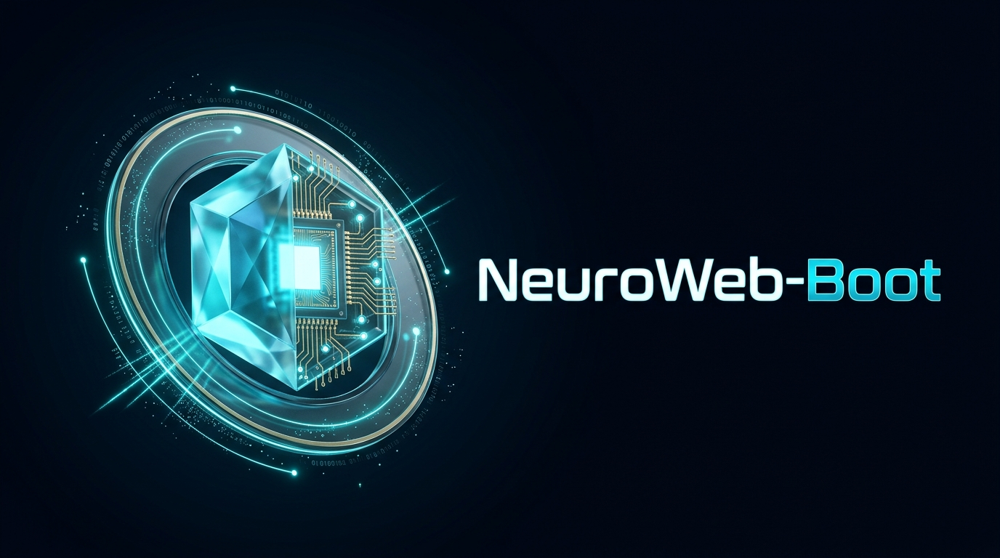

# 🚀 NeuroWeb-Boot Engine

<div align="center">

  
  <br><br>

[](https://github.com/cyberenigma-lgtm/neuroweb-boot)
[](https://github.com/cyberenigma-lgtm/neuroweb-boot)
[-8A6208?style=for-the-badge&logo=shield&logoColor=white)](https://github.com/cyberenigma-lgtm)
[](https://www.safecreative.org/work/2611247743117)
[](THIRD-PARTY-LICENSES.md)
[](https://cyberenigma-lgtm.github.io/neuro-os-live-demo/)

**High-Performance x86_64 WebAssembly Bare-Metal OS Bootloader & VBE Linear Framebuffer Compositor.**  
*Motor de alto rendimiento en WebAssembly para arranque de sistemas operativos bare-metal e imágenes ISO de 64 bits en navegadores web.*

[🇪🇸 Español](#español) | [🇬🇧 English](#english) | [⚖️ Transparencia Legal](#legal-notices)

</div>

---

<a name="español"></a>
## 🇪🇸 Español

### 🧠 ¿Qué es NeuroWeb-Boot?
**NeuroWeb-Boot** es un motor de virtualización ligera y ejecución sobre WebAssembly (`v64`) diseñado específicamente para cargar, inicializar y ejecutar imágenes de disco óptico ISO (`El Torito` / `Multiboot 1/2`) con kernels bare-metal de 64 bits (`x86_64` Long Mode) directamente dentro de cualquier navegador web moderno, sin necesidad de complementos ni virtualizadores pesados de escritorio (como QEMU, VirtualBox o VMware).

---

### ✨ Características Principales
- ⚡ **Arranque Directo de ISOs Bare-Metal:** Carga imágenes ISO en streaming (mediante peticiones HTTP Range optimizadas) e inicializa kernels en Long Mode de 64 bits con aislamiento de tablas de páginas de 4 niveles (`PML4` / `CR3`).
- 🖥️ **Remapeo MMIO LFB VBE (`0xFD000000`):** Puente de memoria física emulada hacia el Canvas HTML5, permitiendo que compositores vectoriales y rutinas gráficas SIMD/SSE2 pinten directamente en el Linear Framebuffer sin fallos de página ni pérdidas de memoria.
- 🎯 **Throttling Adaptativo a 30/60 FPS:** Evita la saturación del hilo gráfico en pantallas de alta tasa de refresco (144Hz+) eliminando llamadas síncronas bloqueantes (`getImageData`) y garantizando fluidez constante.
- 📡 **Telemetría Serie COM1 en Tiempo Real:** Intercepta las interrupciones del puerto serie UART 16550 (`0x3F8`) del microkernel y retransmite las trazas de depuración de Ring-0 directamente a la interfaz web.
- 🕹️ **API Limpia y Modular:** Integración inmediata en pocas líneas de código compatible con ES Modules, React, Vue o JavaScript vanilla.

---

### 📦 Inicio Rápido en JavaScript / Web
```javascript
import { NeuroWebBoot } from "./dist/neuroweb-boot.js";

// Instanciar el motor con la configuración deseada
const vm = new NeuroWebBoot({
    isoUrl: "https://midominio.com/mi-sistema-operativo.iso",
    screenContainer: "#screen_container",
    memorySize: 1024 * 1024 * 1024, // 1024 MB RAM
    fpsLimit: 30,
    fastboot: true,
    onSerialData: (char) => console.log(char),
    onScreenModeChange: (mode) => console.log(`Modo VBE: ${mode.width}x${mode.height} @ ${mode.bpp}bpp`),
    onReady: () => console.log("Kernel x86_64 Long Mode en ejecución")
});

// Arrancar la máquina virtual
await vm.boot();
```

---

### 🛣️ Hoja de Ruta de Soberanía Tecnológica (Modular Sovereignty Roadmap)
NeuroWeb-Boot sigue una estrategia de reemplazo modular progresivo:
1. **Fase 1 (Híbrida Actual):** Orquestación sobre el core de emulación v86 (BSD-2) con capas propias de remapeo MMIO LFB, telemetría COM1, temporizador de blit y SDK `NeuroWebBoot` (Registrado en Safe Creative #`2611247743117`).
2. **Fase 2 (Soberanía de Firmware):** Sustitución de SeaBIOS por **NeuroBIOS**, una ROM mínima de inicialización directa en Long Mode escrita en ensamblador y compilada mediante UPL.
3. **Fase 3 (Soberanía Gráfica Total):** Desacoplamiento de Bochs VBE mediante un driver de pantalla soberano WebAssembly que elimine toda dependencia externa.

---

<a name="english"></a>
## 🇬🇧 English

### 🧠 What is NeuroWeb-Boot?
**NeuroWeb-Boot** is a high-performance, lightweight WebAssembly (`v64`) execution and virtualization engine engineered to stream, initialize, and execute bare-metal 64-bit (`x86_64` Long Mode) operating system ISO images (`El Torito` / `Multiboot 1/2`) directly inside modern web browsers with zero desktop hypervisors (no QEMU, VirtualBox, or VMware required).

---

### ✨ Key Features
- ⚡ **Direct Bare-Metal ISO Boot:** Streams raw ISO images via HTTP Range requests and executes 64-bit Long Mode kernels with 4-level paging (`PML4` / per-process `CR3` isolation).
- 🖥️ **VBE Linear Framebuffer (LFB) MMIO Mapping (`0xFD000000`):** Direct hardware memory mapping from emulated physical RAM to HTML5 Canvas, allowing vector compositors and SIMD/SSE2 graphics routines to blit without page faults.
- 🎯 **30/60 FPS Throttled Canvas Blit:** Prevents browser GPU pipeline stalls on high-refresh displays (144Hz+) by eliminating synchronous blocking readbacks (`getImageData`).
- 📡 **Real-Time COM1 UART Telemetry:** Captures Ring-0 kernel serial debug output (`0x3F8` UART 16550) and streams it directly to browser interfaces.
- 🕹️ **Clean JavaScript/ESM API:** Minimal plug-and-play surface for embedding operating system demos in any web application.

---

### 📦 Quickstart in JavaScript / Web
```javascript
import { NeuroWebBoot } from "./dist/neuroweb-boot.js";

// Initialize the engine with your target kernel ISO
const vm = new NeuroWebBoot({
    isoUrl: "https://mydomain.com/my-operating-system.iso",
    screenContainer: "#screen_container",
    memorySize: 1024 * 1024 * 1024, // 1024 MB RAM
    fpsLimit: 30,
    fastboot: true,
    onSerialData: (char) => console.log(char),
    onScreenModeChange: (mode) => console.log(`VBE Mode: ${mode.width}x${mode.height} @ ${mode.bpp}bpp`),
    onReady: () => console.log("Kernel x86_64 Long Mode running")
});

// Boot the virtual machine
await vm.boot();
```

---

<a name="legal-notices"></a>
## ⚖️ Transparencia Legal, Licencias y Atribución // Legal Notices

Este proyecto opera bajo un modelo de **Obra Derivada e Innovación con Aportación Intelectual Original**, cumpliendo al 100% con la legalidad internacional y las licencias de código abierto:

1. **Aportación Original y Autoría Propia (Safe Creative ID: `2611247743117`):**
   - Arquitectura y SDK `NeuroWebBoot` (`NeuroWebBoot.js`).
   - Algoritmo de remapeo MMIO de Linear Framebuffer en `v86-bochs-vga.js` a `0xFD000000`.
   - Pipeline de throttling y blit no bloqueante a 30/60 FPS.
   - Canal de telemetría serie COM1 para Ring-0.
   - *Titular:* **José Manuel Moreno Cano (Noxferion)**. Sello de Autoridad: `0x4A4D4D43`.

2. **Componentes Base de Terceros (Atribución y Cumplimiento):**
   - **v86 Wasm CPU/MMU Core:** © Fabian Hemmer, distribuido bajo licencia permisiva **BSD 2-Clause**.
   - **SeaBIOS & VGABIOS:** © Kevin O'Connor, Volker Ruppert & contributors, distribuidos bajo **GNU LGPLv3**.

Consulta el desglose legal completo y textos íntegros en: 👉 **[`THIRD-PARTY-LICENSES.md`](THIRD-PARTY-LICENSES.md)**.
